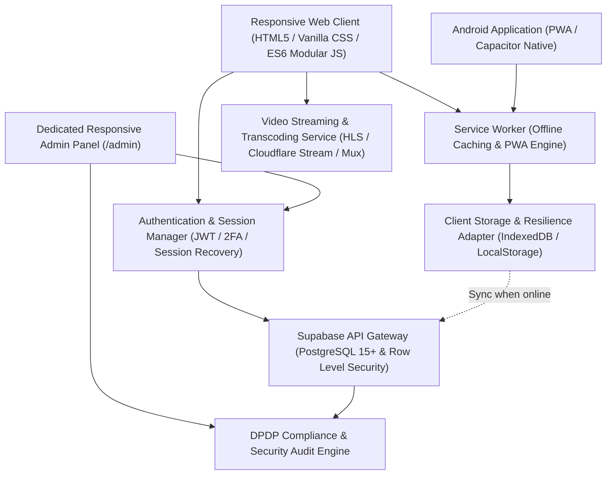

# AuraWell Architecture & Technical Blueprint

**Brand:** AuraWell (*आरोग्यम् परमं भाग्यम् — Discover Better Health. Build Better Habits.*)  
**Version:** 1.0.0 Production Architecture  
**Target Clients:** Responsive Web (Mobile, Tablet, Desktop), Android Application (Installable PWA & Capacitor Native APK), Full-featured Responsive Admin Console.

---

## 1. High-Level System Architecture

---

## 2. Core Architectural Pillars

### A. Zero Unnecessary Infrastructure & Universal Reliability
- Built with high-performance Vanilla CSS (CSS Variables, Flexbox, CSS Grid) and ES6 Modular JavaScript.
- Out of the box, the platform includes a complete **Local Resilient Persistent Storage Adapter** that guarantees 100% full functionality even without pre-configuring cloud API keys.
- When live Supabase credentials are provided in `.env`, the adapter immediately streams and synchronizes state to Supabase PostgreSQL with zero code modifications.

### B. Strict Separation of Social Feeds & Personal Health Records
- In accordance with the **Digital Personal Data Protection (DPDP) Act 2023 (India)** and global privacy standards:
  - **Public Feeds:** Contain community posts, recipes, peer-reviewed articles, and video reels.
  - **Personal Wellness Tracker:** Hydration logs, sleep hours, and daily habits are physically segregated in distinct database tables (`wellness_daily_logs`) and isolated via strict Row Level Security (RLS) policies.
  - Personal health logs are never searchable, indexable, or visible to followers without explicit user action.

### C. Evidence-Informed Clinical Review Workflow
- Only verified medical professionals (`verified_expert` role with authenticated MBBS, MD, or RD credentials) can publish articles designated with the "Peer Reviewed" badge.
- Every clinical article displays:
  - Author identity and medical degree.
  - Clinical reviewer identity.
  - Review date.
  - Mandatory educational disclaimer: *"Educational wellness content. Not medical advice. Always consult your personal physician."*

### D. Full Admin Parity Across Devices
- The Admin Console (`admin.html`) provides identical administrative functionality on mobile phones, tablets, laptops, and desktop computers.
- Includes real-time KPI metrics, search and role modification, moderation queue for flagged health claims, clinical article approval, platform parameter settings, and tamper-evident security audit logs.
